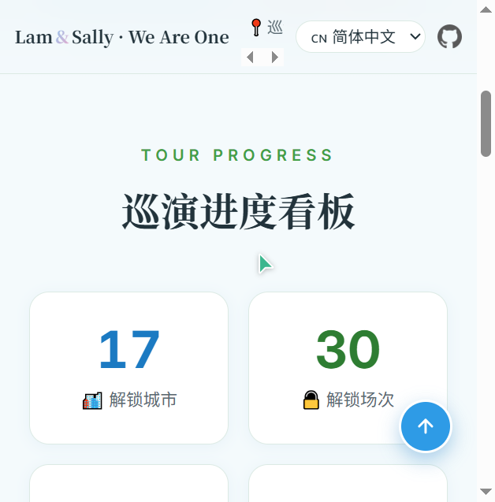
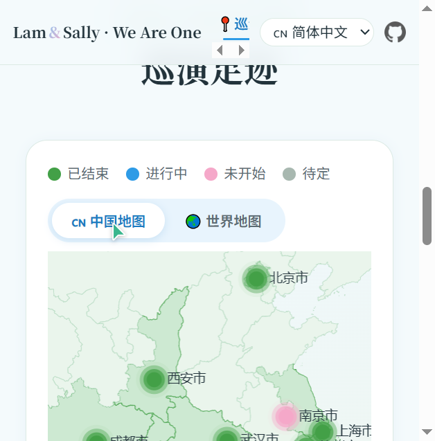
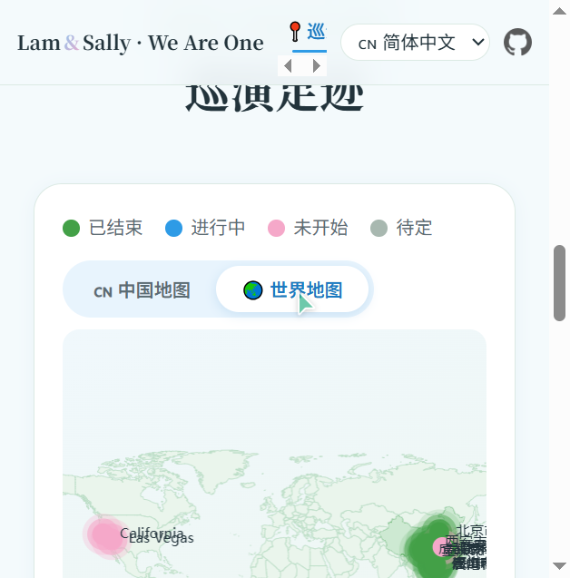
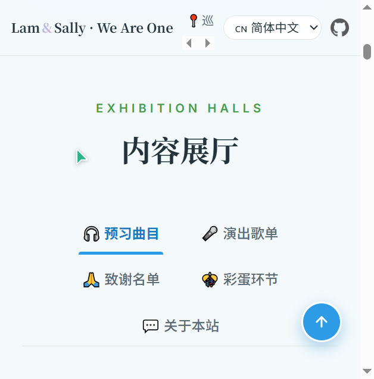
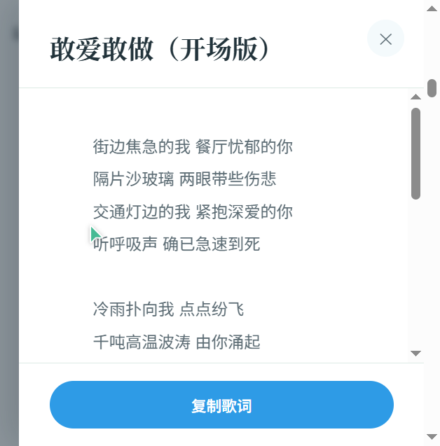
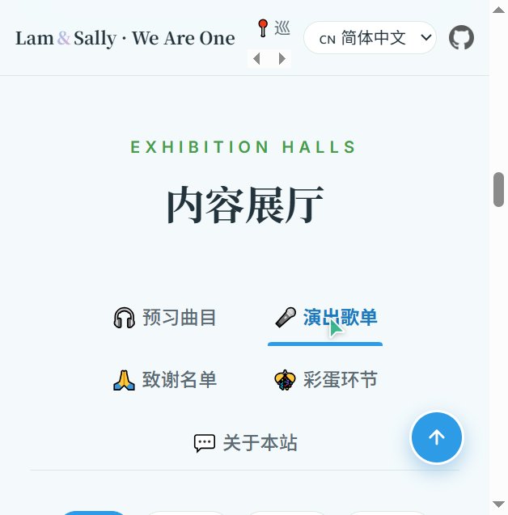
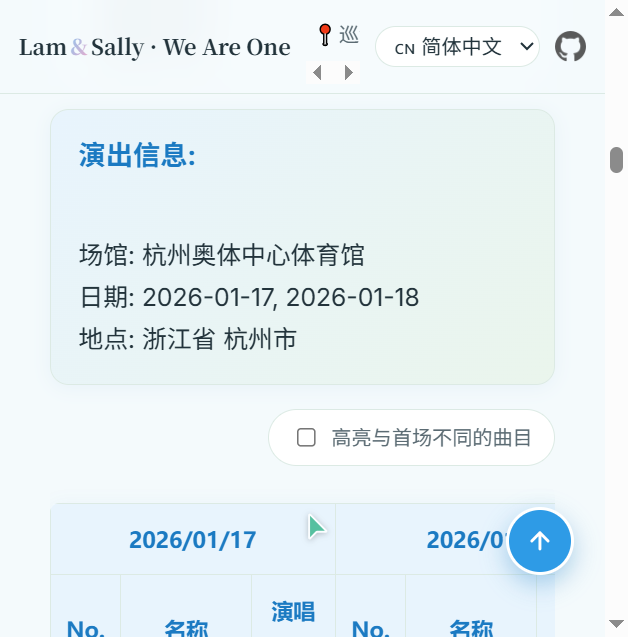
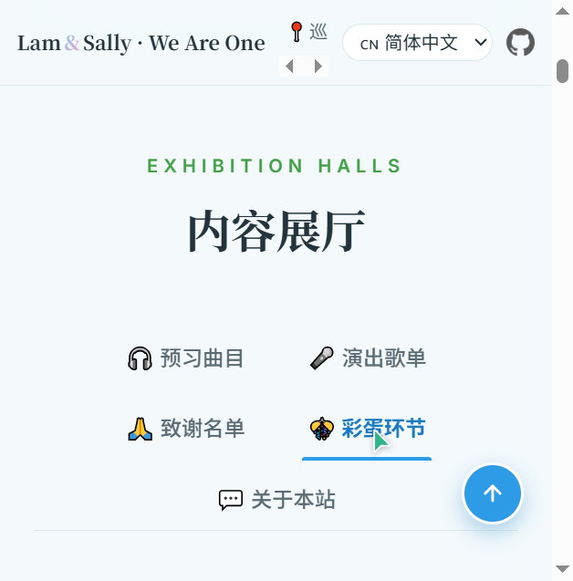
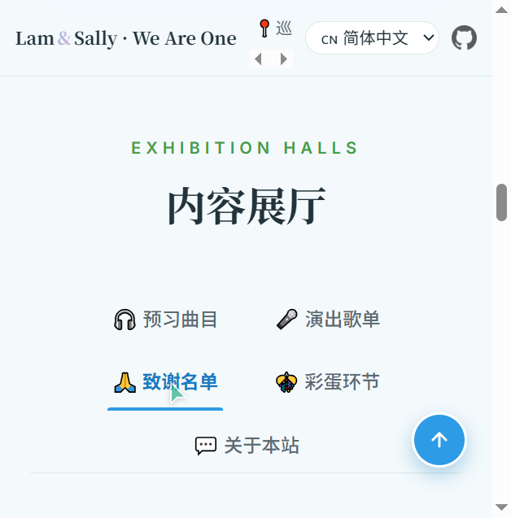

# 林子祥 & 叶蒨文 ❤️ 白头到老 · We Are One 巡演足迹站

> George Lam & Sally Yeh · 《白头到老 / We Are One》世界巡回演唱会 2025–2026 · 野生观察站

一个乐迷自制的演唱会资料站：用地图记录巡演足迹，用歌单沉淀每一站的记忆。

**[在线预览](https://zhonglingyuxiu1028.github.io/we_are_one_tour_route/)** · 施工中，持续更新 \~


## 功能一览

| 模块        | 说明                                           |
| --------- | -------------------------------------------- |
| 📊 巡演进度看板 | 解锁城市 / 场次、完成场次、待完成场次统计，附区域明细表与总进度条           |
| 🗺️ 巡演足迹  | ECharts 中国地图 / 世界地图切换，站点按状态着色，点击直达该站歌单       |
| 🎧 预习曲目   | Chapter1–6 + Encore 分章卡片，曲目支持点击弹出歌词抽屉（可一键复制） |
| 🎤 演出歌单   | 城市卡片 + 状态筛选，多场次歌单并列对比，支持差异高亮                 |
| 🎊 彩蛋环节   | 演出现场彩蛋记录（图文）                                 |
| 🙏 致谢名单   | 官方账号链接卡、Rolling 视频传送门、在线协作文档入口               |
| 🌐 多语言    | 简体中文 / 繁體中文 / English 一键切换                   |
| 💞 小彩蛋    | 页面内单击 / 长按鼠标，会有爱心表情飘出                        |

## 页面截图

### 巡演进度看板

数字滚动 + 进度条动画（进入视野时触发），可展开查看中国 / 海外区域明细。



### 巡演足迹

站点颜色含义：绿 = 已结束、蓝 = 进行中、粉 = 未开始、灰 = 待定（未官宣）。同一城市多站会自动错开坐标，点击站点即可查看该站歌单。

| 中国地图                                    | 世界地图                                    |
| --------------------------------------- | --------------------------------------- |
|  |  |

### 预习曲目

Markdown 曲目表自动章节卡片化，演唱人以双色圆点区分（双点 = 合唱）；蓝色曲名可点击打开歌词抽屉。



歌词抽屉支持一键复制歌词，`Esc` 或点击遮罩关闭。



### 演出歌单

进入后先看到城市卡片与状态筛选（全部 / 已结束 / 进行中 / 未开始）：



点击城市卡片加载该站歌单；多场次站点会以并列表格对比呈现，勾选「差异高亮」可标出各场不同曲目：



### 彩蛋环节 / 致谢名单





## 技术栈

* **零构建**：原生 HTML / CSS / JavaScript，无框架、无打包工具，克隆即用

* [ECharts](lib/echarts.min.js)：中国地图 + 世界地图（GeoJSON 本地化）

* [marked.js](lib/marked.min.js)：Markdown 内容渲染（曲目、歌单、彩蛋、致谢）

* [SimpleLightbox](lib/simple-lightbox.min.js)：图片灯箱

* 自研轻量 i18n（`js/i18n/`）：三语 JSON 字典 + `data-i18n` 属性替换，语言偏好存 localStorage

* 自定义字体子集：Noto Serif SC / Noto Sans SC / Inter 按站点实际文案子集化（见 `tools/subset-fonts.js`）

* 交互细节：hash 路由直达展厅、scroll-spy 导航高亮、IntersectionObserver 入场/计数动画、回到顶部等

## 目录结构

```text
├── index.html            # 单页入口（地图 + 展厅骨架）
├── css/                  # 样式（tokens / style / setlist / 统计表 / 灯箱等）
├── js/
│   ├── app.js            # 地图渲染、行程解析、站点点击 → 歌单
│   ├── tabs.js           # 展厅 Tab、hash 路由、内容增强（章节卡/对比表/歌词抽屉等）
│   ├── i18n.js + i18n/   # 多语言（zh-CN / zh-HK / en）
│   ├── statistical-table.js  # 进度看板渲染
│   ├── emoji-effect.js   # 点击爱心特效
│   └── back-to-top.js    # 回到顶部
├── data/
│   ├── json/itinerary.json        # 巡演行程（站点/日期/坐标）
│   ├── json/statistical-table.json# 进度看板统计
│   ├── songlist.md                # 预习曲目
│   ├── bonus.md / credits.md / about.md
│   ├── setlist/                   # 各站歌单（<城市>.html 优先，.md 回退）
│   └── lyrics/                    # 歌词 Markdown（按章节分目录）
├── img/                  # 图片素材
├── fonts/                # 子集化字体（woff2）
├── lib/                  # 第三方库（本地化）
├── tools/subset-fonts.js # 字体子集化脚本
└── docs/                 # 设计文档 + README 截图（docs/screenshots/）
```

## 本地运行

页面依赖 `fetch` 加载数据，**不能直接双击 index.html 打开**，需要一个静态 HTTP 服务：

```bash
# 任选其一，在项目根目录执行
npx serve .                 # Node
python -m http.server 8000  # Python
# 或使用 VS Code 的 Live Server 插件
```

浏览器访问 `http://localhost:8000`（或对应端口）即可。

## 数据维护指南

### 新增 / 更新巡演站点

编辑 [data/json/itinerary.json](data/json/itinerary.json)，每个站点字段：

```json
{
  "name": "#05 杭州站 Hangzhou",
  "location": "杭州奥体中心体育馆",
  "setlist-name": "hangzhou",
  "date": "2026-01-17, 2026-01-18",
  "coord": [120.230349, 30.228173],
  "city": "杭州市",
  "province": "浙江省",
  "country": "China"
}
```

* `date` 支持三种格式：`2025-10-09 至 2025-10-13`、`2025-11-15, 2025-11-16`、单日 `2025-11-29`；名称含「未官宣」或日期无效时按「待定」处理

* `country` 为 `China` 时进入中国地图，否则进入世界地图

* `setlist-name` 对应 `data/setlist/<setlist-name>.html`（优先）或 `.md`（回退）；文件不存在时展示「未发布 / 未官宣」提示

### 歌单 / 曲目 / 歌词

* 各站歌单放 `data/setlist/`，多场次对比表请参考现有 HTML 的 `date-header` / `label-header` / `chapter-row` 结构（差异高亮依赖此结构）

* 预习曲目在 [data/songlist.md](data/songlist.md) 中维护；曲名写成
  `<span class="lyric-trigger" data-lyric-file="chapter1/xxx.md">歌名</span>`
  即可点击弹出歌词，歌词文件放 `data/lyrics/` 对应章节目录

* 进度看板数字在 [data/json/statistical-table.json](data/json/statistical-table.json) 中手工同步

### 多语言与字体

* 文案翻译维护 `js/i18n/{zh-CN,zh-HK,en}.json`

* 站点新增了文案（新汉字）后需重新生成字体子集，见 [tools/subset-fonts.js](tools/subset-fonts.js) 文件头注释

## 部署

纯静态站点，推送到 GitHub 后在仓库 Settings → Pages 开启 GitHub Pages 即可自动部署（当前即通过此方式发布）。

## 说明

* 本站为乐迷自制「野生观察站」，非官方站点，仅作资料整理与分享

* 感谢 Lam & Sally、所有工作人员，以及提供素材与帮助的热心网友们

* Design By Michelle Chung © 2025-2026

